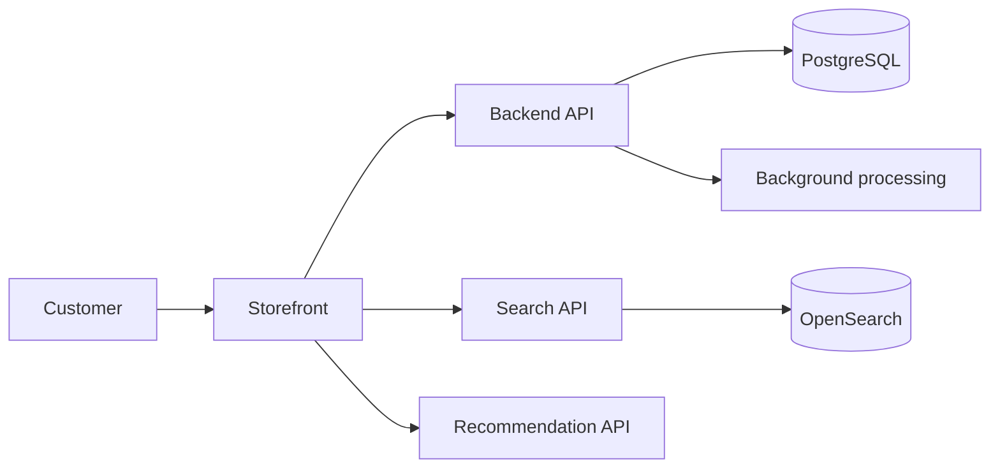

# 24sparts — engineering case study

**Domain:** spare-parts discovery and custom manufacturing requests for professional food-service equipment.

**Status:** individual development project. Source code is private. This public case describes the technical approach at a high level; no customer records, production credentials, proprietary source or commercial performance claims are included.

## Problem

Finding a compatible spare part is difficult when identifiers, dimensions and compatibility information are incomplete. The intended product combines a searchable catalog with a request flow for parts that cannot be found off the shelf.

## Technical approach

- Next.js / React storefront with TypeScript.
- Django and Django REST Framework backend.
- PostgreSQL for transactional data, Redis and Celery for background processing.
- Dedicated search and recommendation service boundaries; OpenSearch for retrieval.
- Docker Compose and Nginx for service configuration and ingress.

The diagram is a conceptual overview, not a map of production network access. Dependency and service definitions demonstrate the chosen stack; they do not prove that every business workflow is complete.

## Engineering considerations

- Separate catalog retrieval from transactional order logic.
- Keep custom requests distinct from confirmed inventory or compatibility claims.
- Validate specifications before committing to manufacturing or pricing.
- Use explicit failure states when a service is unavailable.
- Keep confidential deployment settings and customer data outside the public portfolio.

## Next validation milestones

A reproducible catalog-search demo, a custom-part request walkthrough using synthetic data, a traceable test run and a documented performance baseline. No sales, uptime, conversion or fulfillment metrics are asserted.

## Authorship

Individual, AI-assisted project. This case is intentionally limited to high-level architecture and product intent.
